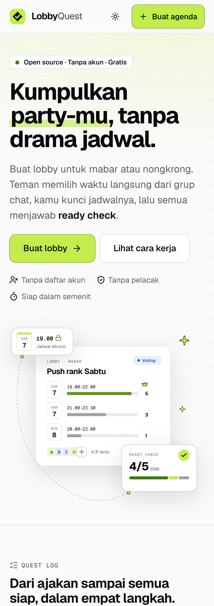
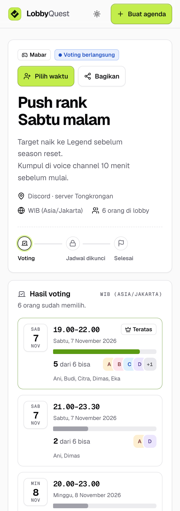
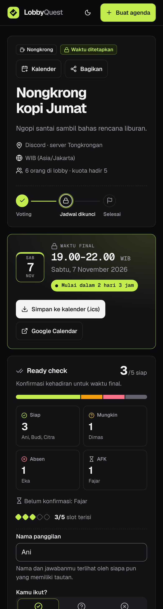
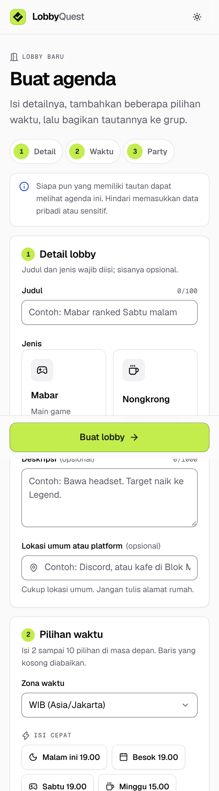

# LobbyQuest

[](https://github.com/JudikaM/lobbyquest/actions/workflows/ci.yml)
[](LICENSE)

Web open source untuk membuat janji mabar dan nongkrong bersama teman: buat
agenda, voting waktu, tetapkan jadwal, lalu *ready check*. Tanpa akun, tanpa
pelacak.

*An open-source, account-free scheduler for gaming sessions and hangouts with
friends: propose times, let friends vote, lock in the final time, and run a
ready check. Interface in Indonesian.*

<p align="center">
  
  
  
  
</p>

## Fitur

**Alur utama**

- **Buat agenda** mabar atau nongkrong dengan 2–10 pilihan waktu (WIB, WITA,
  atau WIT; zona perangkat dipilih otomatis).
- **Voting waktu.** Teman cukup menulis nama panggilan dan mencentang waktu yang
  bisa. Hasilnya tampil sebagai bar ketersediaan.
- **Tetapkan waktu final** dari hasil voting. Pengelola bisa menggantinya atau
  membuka voting lagi.
- **Ready check.** Peserta mengonfirmasi *hadir*, *mungkin*, atau *tidak hadir*,
  dan bisa mengubahnya dari browser yang sama.
- **Status jelas.** Agenda selalu menampilkan tahapannya: voting, waktu
  ditetapkan, atau selesai.

**Tambahan**

- Kuota party opsional (misalnya 5 untuk satu squad), lengkap dengan indikator
  slot terisi.
- Hitung mundur ke waktu final, plus jam versi zona waktu perangkat jika
  berbeda dengan zona agenda.
- Simpan ke kalender (`.ics`) atau Google Calendar.
- Bagikan dengan tombol salin, lembar berbagi bawaan ponsel, WhatsApp, atau
  Telegram.
- Preview tautan (Open Graph) yang rapi saat link dibagikan di grup chat.
- Mode terang/gelap mengikuti perangkat, ramah ponsel, dan dirancang
  aksesibel: label form, fokus terlihat, navigasi keyboard, serta tanpa temuan
  pada pemeriksaan otomatis axe-core (WCAG 2.1 AA).

**Privasi**

- Tanpa akun, email, nomor HP, analytics, iklan, atau aset pihak ketiga.
- Peserta bisa menghapus namanya sendiri; pengelola bisa menghapus agenda.
- Agenda dihapus otomatis setelah `RETENTION_DAYS` hari (bawaan 30) sejak
  pilihan waktu terakhir.

## Mulai cepat

Kebutuhan: [Node.js](https://nodejs.org/) 22 atau lebih baru (npm sudah
termasuk).

```sh
git clone https://github.com/JudikaM/lobbyquest.git
cd lobbyquest
npm install
npm start
```

Buka <http://localhost:3000>. Status aplikasi tersedia di
<http://localhost:3000/health>.

| Perintah        | Fungsi                                                    |
| --------------- | --------------------------------------------------------- |
| `npm start`     | Menjalankan server.                                       |
| `npm run dev`   | Menjalankan server dan memuat ulang otomatis saat file berubah. |
| `npm test`      | Menjalankan seluruh test (`node:test`, database di memori). |
| `npm run lint`  | Memeriksa kode dengan ESLint.                             |

### Catatan Windows

- PowerShell: jika muncul galat `npm.ps1 cannot be loaded because running
  scripts is disabled`, jalankan
  `Set-ExecutionPolicy -Scope CurrentUser -ExecutionPolicy RemoteSigned`,
  atau pakai `npm.cmd start`.
- Mengatur variabel lingkungan: `$env:PORT = 4000` (PowerShell) atau
  `set PORT=4000` (cmd), lalu `npm start`.

## Konfigurasi

Semua konfigurasi dibaca dari environment variable. Contoh lengkap ada di
[`.env.example`](.env.example). Salin menjadi `.env` (tidak ikut ke Git) lalu
jalankan `node --env-file=.env src/server.js`.

| Variabel         | Bawaan                 | Keterangan |
| ---------------- | ---------------------- | ---------- |
| `NODE_ENV`       | `development`          | `production` mengaktifkan cookie `Secure`, HSTS, dan mewajibkan `APP_SECRET`. |
| `PORT`           | `3000`                 | Port HTTP. |
| `DATABASE_PATH`  | `data/lobbyquest.db`   | Lokasi file SQLite. Folder dibuat otomatis. |
| `APP_SECRET`     | acak per proses        | Secret minimal 32 karakter untuk token CSRF. **Wajib di production.** |
| `PUBLIC_URL`     | –                      | URL publik, misalnya `https://lobbyquest.example`. Dipakai untuk tautan berbagi, kalender, dan preview. Sangat disarankan di production. |
| `TRUST_PROXY`    | –                      | Isi jika berada di belakang reverse proxy (misalnya `1` atau `loopback`) agar IP klien dan HTTPS terbaca benar. |
| `RETENTION_DAYS` | `30`                   | Agenda dihapus otomatis sekian hari setelah pilihan waktu terakhir. |

Membuat `APP_SECRET`:

```sh
node -e "console.log(require('crypto').randomBytes(32).toString('base64url'))"
```

### Menjalankan di production

1. Atur `NODE_ENV=production`, `APP_SECRET`, dan `PUBLIC_URL`.
2. Jalankan di belakang reverse proxy dengan HTTPS (misalnya Caddy atau Nginx)
   dan atur `TRUST_PROXY` sesuai jumlah proxy.
3. Simpan `DATABASE_PATH` di volume persisten dan sertakan dalam backup. File
   database berisi data peserta, jadi jangan diletakkan di folder yang
   disajikan web server.
4. Aplikasi menutup koneksi dengan rapi saat menerima `SIGTERM`.

## Arsitektur

Server-rendered tanpa framework frontend: Express 5, EJS, dan SQLite
(better-sqlite3). JavaScript di browser hanya menambah kenyamanan (salin
tautan, hitung mundur, zona waktu lokal). Semua fitur inti tetap berjalan
tanpa JavaScript.

```
src/
├── server.js          # entry point: konfigurasi, listen, retensi, shutdown
├── app.js             # createApp(): middleware keamanan, view, route, error
├── config.js          # membaca & memvalidasi environment variable
├── routes.js          # route aplikasi dan view model halaman agenda
├── agendas.js         # validasi, penyimpanan, status, dan waktu final agenda
├── participants.js    # identitas peserta (token di cookie, hash di database)
├── votes.js           # voting pilihan waktu
├── rsvp.js            # konfirmasi kehadiran dan kuota party
├── managers.js        # token pengelola (hash + perbandingan constant-time)
├── retention.js       # penghapusan otomatis agenda kedaluwarsa
├── calendar.js        # ekspor .ics dan tautan Google Calendar
├── share.js           # teks dan tautan berbagi
├── presenters.js      # helper tampilan (avatar, bar ketersediaan)
├── text.js            # pembersihan input teks
├── time.js            # konversi zona waktu dan format tanggal
├── urls.js            # origin publik untuk URL absolut
├── security/          # headers (CSP), CSRF, rate limit, cookie, body
├── ui/                # helper ikon Lucide (icons.js, icon-names.js, registry)
├── db/
│   ├── index.js       # koneksi SQLite dan runner migrasi
│   └── migrations/    # file .sql berurutan, dijalankan otomatis saat start
├── views/             # template EJS (partials/ui berisi komponen bersama)
└── public/            # app.css (token + komponen), app.js, font, ikon, gambar
test/                  # test node:test (unit + integrasi HTTP)
```

### Model akses

- **Peserta** diwakili token acak di cookie `httpOnly` yang hanya berlaku untuk
  satu agenda. Database hanya menyimpan hash SHA-256 token, sehingga dua orang
  dengan nama sama tetap dibedakan dan pilihan hanya bisa diubah dari browser
  yang sama.
- **Pengelola** (pembuat agenda) menerima token 256-bit di cookie `httpOnly`
  saat membuat agenda. Database hanya menyimpan hash-nya, dan pemeriksaan
  memakai perbandingan constant-time. Untuk mengelola dari perangkat lain,
  tautan pengelola membawa kode di fragment URL (`#kode=…`) yang tidak pernah
  dikirim ke server. Kode dikirim lewat POST, lalu dihapus dari bilah alamat.
- **Agenda** memakai ID acak 96-bit di URL, sehingga tidak bisa ditebak atau
  di-enumerasi. Siapa pun yang memiliki tautan bisa melihat agenda. Karena itu
  aplikasi mengingatkan pengguna agar tidak menulis data pribadi.

### Keamanan

- Semua query SQL memakai prepared statement.
- Template memakai output ter-escape (`<%= %>`). Output mentah hanya untuk
  partial internal.
- Content-Security-Policy ketat (`default-src 'none'`, skrip, gaya, dan font
  hanya dari origin sendiri, tanpa inline) serta security headers lain lewat
  Helmet.
- Proteksi CSRF *signed double-submit* untuk semua form, ditambah pemeriksaan
  `Sec-Fetch-Site`/`Origin`.
- Rate limiting untuk pembuatan agenda, voting/RSVP, dan aksi pengelola.
- Validasi dan batas panjang semua input di server, termasuk pembersihan
  karakter kontrol dan *bidi override*.
- Halaman error tidak pernah menampilkan stack trace atau detail server.

Lihat [SECURITY.md](SECURITY.md) untuk cara melaporkan celah keamanan.

## Sistem desain

Antarmuka memakai sistem desain internal bernama **Ready Room**: permukaan
netral ala shadcn/ui (`background`/`card`/`muted`/`border`/`ring`, dan
seterusnya) dipadukan dengan satu warna sinyal, **Volt**, untuk momen
penting seperti status *siap* dan tombol utama. Semua token warna, radius,
spacing, dan tipografi ada sebagai CSS custom property di
[`src/public/app.css`](src/public/app.css); setiap token dan komponen bisa
dilihat langsung di halaman **[`/desain`](/desain)** saat aplikasi berjalan.

- **Tipografi.** [Geist dan Geist Mono](https://github.com/vercel/geist-font),
  di-subset ke glyph yang dipakai dan di-host sendiri dengan `font-display:
  swap` (total sekitar 26 KB).
- **Ikon.** Seluruhnya dari [Lucide](https://lucide.dev) (set ikon shadcn/ui)
  lewat paket `lucide-static`, dirender sebagai SVG inline oleh
  `src/ui/icons.js`. Tidak ada ikon dimuat dari CDN.
- **Komponen.** Button, input, card, badge, alert, toast, dialog/sheet
  (dibangun di atas `<dialog>` asli), tabs, avatar, progress, dan skeleton,
  semuanya CSS + partial EJS tanpa library JavaScript. `src/public/app.js`
  hanya menambah peningkatan progresif (toast, dialog, tab, tooltip);
  setiap halaman tetap berfungsi tanpa JavaScript.
- **Mode gelap/terang.** Mengikuti preferensi sistem secara default, dengan
  toggle manual yang diingat lewat cookie preferensi tampilan (bukan data
  pribadi) dan dibaca di server agar halaman langsung tampil benar tanpa
  kedipan.
- **Aksesibilitas.** Target sentuh minimal 44px, fokus selalu terlihat,
  navigasi keyboard penuh (menu, tab, dialog), dan diperiksa dengan
  [axe-core](https://github.com/dequelabs/axe-core) di setiap halaman, tema,
  dan lebar layar (375/768/1440px) — nol pelanggaran WCAG 2.1/2.2 AA pada
  commit saat ini.

Atribusi lengkap pihak ketiga (lisensi ISC Lucide, MIT Feather, dan OFL
Geist) ada di [NOTICE.md](NOTICE.md).

## Berkontribusi

Kontribusi sangat diterima. Baca [CONTRIBUTING.md](CONTRIBUTING.md) untuk alur
kerja, gaya commit, dan checklist sebelum membuka pull request. Riwayat
perubahan ada di [CHANGELOG.md](CHANGELOG.md).

## Lisensi

[MIT](LICENSE). Ikon, font, dan aset pihak ketiga lainnya memakai lisensinya
masing-masing — lihat [NOTICE.md](NOTICE.md).
